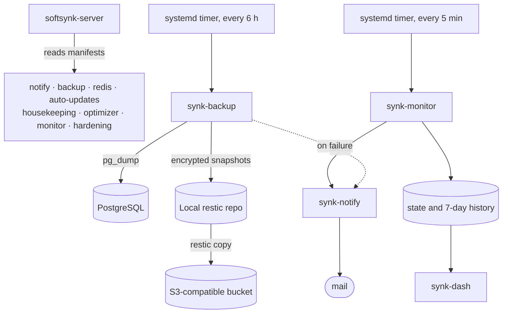

<div align="center">

# Synk Server Manager

**Backups, Redis, updates, monitoring and safe tuning for your Ubuntu server, set up and checked with one command.**

[](LICENSE)


[Why](#-why-it-exists) · [What you get](#-what-you-get) · [How it works](#-how-it-works) · [Quick start](#-quick-start) · [CLI](#-the-interactive-cli) · [Reference](#-reference)

</div>

---

## 💡 Why it exists

Running your own VPS is cheap. Running it **well** is not. A few jobs decide whether a small server survives a bad day, and they are usually done by hand, once, and then forgotten:

- 🗄️ **Backups** that are encrypted, off-site, pruned sensibly and *actually restorable*.
- ⚡ **Redis** tuned so the cache can never evict your queued jobs.
- 🔄 **Security updates** that install themselves and reboot only when needed.
- 📈 **Warnings** about a full disk or a dead service before your users notice.
- 🔐 **SSH and firewall settings** that are tightened without locking you out.

Getting any of these wrong is silent until the day it matters. Synk Server Manager (`softsynk-server` command) turns each one into a small, auditable module you can install, re-check and roll back.

**Built for** developers and small teams running their own Ubuntu server (Laravel, Rails, Django, Node and similar stacks) who want production-grade basics without a backup SaaS or a configuration-management platform.

## 🎯 What you get

| The usual problem | What Synk Server Manager does |
|---|---|
| Backups exist, but nobody has tested a restore | 🗄️ **`backup`** dumps every PostgreSQL database plus its roles every 6 hours into an encrypted [restic](https://restic.net) repository, copies it to any S3-compatible bucket (presets for Cloudflare R2, Backblaze B2 and Hetzner), and **restores a sample every 30 days** to prove it works |
| A week of failed backups quietly deletes the good ones | Retention counts **only successful backups**, and a failed off-site copy is retried on the next run |
| One Redis for cache and queue, so jobs get evicted | ⚡ **`redis`** runs **separate cache and queue instances** (or one), with memory limits, eviction policy, persistence, a password and localhost-only binding. It adopts an existing setup instead of overwriting it |
| Security patches wait for someone to log in | 🔄 **`auto-updates`** configures unattended-upgrades for security and stable updates plus chosen third-party repos (PHP from sury, nginx.org), reboots at a set time only when required, and verifies the result with a dry run |
| Every script mails you differently, or not at all | ✉️ **`notify`** is one mail setup (SMTP, Resend, Mailgun or sendmail) shared by all modules. Any systemd unit can mail you when it fails |
| You learn about a full disk from your users | 📈 **`monitor`** checks disk, memory, CPU, services and failed units every 5 minutes, keeps 7 days of history and mails what is wrong and what to run. **`synk-dash`** shows it live in the terminal |
| Logs and caches quietly fill the disk | 🧹 **`housekeeping`** (`synk-clean`) previews what can safely go and deletes it only after a yes, caps the journal and rotates Laravel logs |
| Hardening SSH is how people lock themselves out | 🔐 **`hardening`** (`synk-harden`) audits SSH and ufw, refuses without proof you logged in with a key, and **reverts itself after 10 minutes** unless you confirm from a new session |
| Default PHP, Nginx and cache settings ignore your RAM | ⚙️ **`optimizer`** (`synk-tune`) compares settings with the server's RAM and CPUs and reports what to change. It applies only an OPcache drop-in, with validation and rollback |
| "How did we set this server up again?" | Every module has the same wizard, the same health check and the same commands |

## 🔧 How it works

1. **Pick modules** from an interactive menu, or name them on the command line.
2. **Answer a short wizard.** All answers are validated *before* anything changes, and `--dry-run` shows the plan without touching the system.
3. **Check health any time.** Every module reports `healthy`, `degraded` or `unhealthy` as text or JSON.



The engine contains no module-specific code. A module is a folder with a data-only manifest that declares its dependencies, platforms and commands, so adding your own is straightforward. See [Architecture](docs/architecture.md).

## ✨ Key features

- 🛡️ **Safe by default.** Validate first, change second. Edits to system files are backed up and put back byte for byte if the check fails. Secrets are accepted only through prompts or environment variables, never as options visible in `ps`.
- ⏪ **Instant rollback.** Each release is installed read-only in its own folder behind a `current` symlink. `softsynk-server --rollback` switches back.
- 🪶 **No new runtime.** Python (standard library only) plus Bash. The only extra packages are `gum` and `restic`, both from the Ubuntu archive.
- 🤖 **Scriptable.** Every module runs with `--non-interactive`, reports health as JSON, and shares one set of exit codes.
- 🔍 **Auditable.** Plain scripts and TOML manifests you can read in an afternoon.

## 🚀 Quick start

**You need:** Ubuntu with systemd, root access, Python 3.11+ and Bash 4.4+. The backup module needs Ubuntu 26.04+, `restic` 0.17.1+ and the PostgreSQL client tools. The notify, monitor, housekeeping, hardening and optimizer modules need Ubuntu 24.04+. The Redis module also runs on Debian.

**1. Build a release** on your own machine, from a clone of this repo:

```bash
git archive --format=tar.gz --prefix="softsynk-server-$(cat VERSION)/" -o "softsynk-server-$(cat VERSION).tar.gz" HEAD
shasum -a 256 "softsynk-server-$(cat VERSION).tar.gz"
```

**2. Install it** on the server as root, after copying the tarball there:

```bash
tar -xzf softsynk-server-0.2.0.tar.gz
bash softsynk-server-0.2.0/bootstrap.sh --from softsynk-server-0.2.0.tar.gz --sha256 <sha256-from-step-1> --install
```

`--install` installs `gum` with apt and opens the module menu. The release lands in `/opt/softsynk-server-management`, with `softsynk-server` and every module command (`synk-backup`, `synk-notify`, `synk-monitor` and so on) linked into `/usr/local/bin`.

**3. Set up mail and monitoring** (optional, recommended):

```bash
/usr/local/bin/synk-notify configure
/usr/local/bin/synk-notify test
/usr/local/bin/synk-monitor setup
```

**4. Check health:**

```bash
softsynk-server --status
```

**Moving to a new server?** Install the same release there, copy `etc/` and `secrets/` from the old management root to the new one (keep their modes, for example with `rsync -a`), then run `softsynk-server install`. Modules that store settings start their setup from those answers and validate them on the new machine. Monitor history, state and the local backup repository stay behind; the off-site backup copy does not.

## 💻 The interactive CLI

Run `softsynk-server` with no arguments to open the menu. Use the arrow keys to move and Enter to choose:


Menus and prompts use [gum](https://github.com/charmbracelet/gum) when it is installed and fall back to plain numbered prompts when it is not. Ctrl-C or Esc cancels at any point.

**Health at a glance** (example output):

```console
# softsynk-server --status
softsynk-server 0.2.0 (interface 1), root /opt/softsynk-server-management
MODULE        INSTALL    HEALTH   SUMMARY
notify        installed  healthy  ...
backup        installed  healthy  ...
redis         adopted    healthy  ...
auto-updates  installed  healthy  ...
housekeeping  installed  healthy  ...
optimizer     installed  healthy  ...
monitor       installed  healthy  ...
hardening     installed  healthy  ...
overall: healthy (exit 0)
```

**No terminal? No problem.** Answer prompts ahead of time with `SOFTSYNK_ANSWER_<NAME>` variables and run without a single question:

```bash
env SOFTSYNK_ANSWER_REPO_PASSWORD='...' SOFTSYNK_ANSWER_S3_ACCESS_KEY_ID='...' \
  SOFTSYNK_ANSWER_S3_SECRET_ACCESS_KEY='...' \
  deployment/backup/setup-backup.sh --non-interactive \
  --remote-preset r2 --remote-id ACCOUNT_ID --remote-bucket my-bucket
```

## 📖 Reference

<details>
<summary><b>Everyday commands</b></summary>

```bash
softsynk-server                       # interactive menu
softsynk-server install backup        # install one module (dependencies first)
softsynk-server configure redis       # change a module's settings
softsynk-server --list                # modules, install state, blockers
softsynk-server --status --json       # health for monitoring
softsynk-server update --from softsynk-server-0.2.0.tar.gz --sha256 <hex>
softsynk-server --rollback            # back to the previous release

synk-backup --status                  # backup health and last runs
synk-backup snapshots --from remote   # what is in the bucket
synk-backup run --dry-run             # what the next run would do
synk-backup restore --db app --to-db app_restored   # restore beside the live database

synk-notify test                      # send a test mail
synk-monitor report                   # current state, as the alert mail shows it
synk-dash                             # live terminal view (q quits)
synk-clean scan                       # what fills the disk, what can be cleaned
synk-clean run                        # preview, ask, clean
synk-harden audit                     # SSH and firewall findings, read-only
synk-harden apply                     # apply with the auto-revert timer; confirm from a NEW session
synk-tune audit                       # tuning findings for PHP, Nginx, Redis and more
```

</details>

<details>
<summary><b>Exit codes</b></summary>

| Code | Meaning |
|---|---|
| `0` | Healthy, or done |
| `1` | Degraded |
| `2` | Unhealthy, or a module failed |
| `3` | Incomplete or unknown |
| `64` | Invalid request or missing required input |
| `130` | Cancelled |

</details>

### 📚 Documentation

| Topic | Where |
|---|---|
| Mail: presets, failure mail for any unit | [deployment/notify/README.md](deployment/notify/README.md) |
| Backups: retention, setup, restore, health | [deployment/backup/README.md](deployment/backup/README.md) |
| Redis: modes, defaults, Laravel `.env` | [deployment/redis-setup/README.md](deployment/redis-setup/README.md) |
| Automatic updates: defaults, checks | [deployment/auto-updates/README.md](deployment/auto-updates/README.md) |
| Disk cleanup: categories, safety rules | [deployment/housekeeping/README.md](deployment/housekeeping/README.md) |
| Server tuning: audit findings, OPcache drop-in | [deployment/optimizer/README.md](deployment/optimizer/README.md) |
| Health monitor and dashboard: alerts, config | [deployment/monitor/README.md](deployment/monitor/README.md) |
| SSH and firewall hardening: lockout guard, revert | [deployment/hardening/README.md](deployment/hardening/README.md) |
| Layout, commands, update and rollback | [docs/architecture.md](docs/architecture.md) |
| Write your own module | [docs/module-development.md](docs/module-development.md) |
| Why restic, and the rejected alternatives | [docs/decisions/0001-backup-and-server-management.md](docs/decisions/0001-backup-and-server-management.md) |
| Why the ops toolkit looks the way it does | [docs/decisions/0002-ops-toolkit.md](docs/decisions/0002-ops-toolkit.md) |

## ⚠️ Project status

**0.2.0 is an early release.** The logic (retention, alert states, cleanup rules, lockout checks, tuning formulas, manifest validation, status, update and rollback) is covered by more than 600 automated tests that stub system tools, plus a real PostgreSQL and restic smoke test. Behaviour against live systemd, apt, ufw, sshd, PHP-FPM, S3 providers and mail servers has **not** yet been validated on a production server. Try it on a disposable VM first, and keep your existing backups until you have done a test restore.

## 🤝 Contributing

Bug reports, fixes and new modules are welcome. Start with [CONTRIBUTING.md](CONTRIBUTING.md). Report security issues privately as described in [SECURITY.md](SECURITY.md).

## ⚖️ License

[CC0-1.0](LICENSE): dedicated to the public domain. Use, modify and share it for any purpose, including commercially, with no permission or attribution needed.
