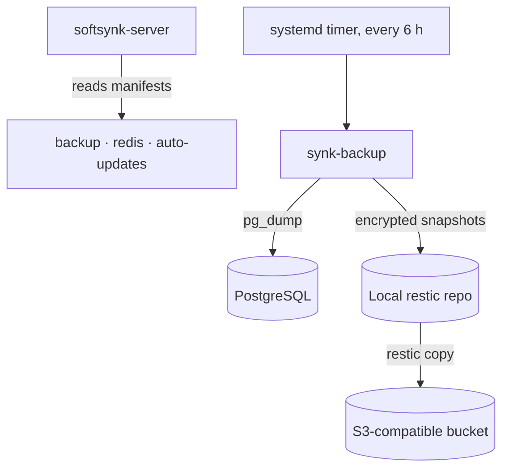
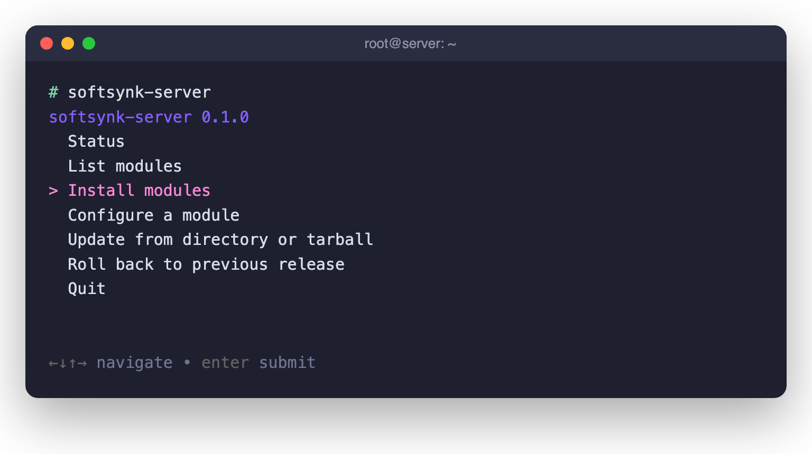

<div align="center">

# softsynk-server

**Backups, Redis and security updates for your Ubuntu server, set up and checked with one command.**

[](LICENSE)


[Why](#-why-it-exists) · [What you get](#-what-you-get) · [How it works](#-how-it-works) · [Quick start](#-quick-start) · [CLI](#-the-interactive-cli) · [Reference](#-reference)

</div>

---

## 💡 Why it exists

Running your own VPS is cheap. Running it **well** is not. Three jobs decide whether a small server survives a bad day, and they are usually done by hand, once, and then forgotten:

- 🗄️ **Backups** that are encrypted, off-site, pruned sensibly and *actually restorable*.
- ⚡ **Redis** tuned so the cache can never evict your queued jobs.
- 🔄 **Security updates** that install themselves and reboot only when needed.

Getting any of these wrong is silent until the day it matters. softsynk-server turns each one into a small, auditable module you can install, re-check and roll back.

**Built for** developers and small teams running their own Ubuntu server (Laravel, Rails, Django, Node and similar stacks) who want production-grade basics without a backup SaaS or a configuration-management platform.

## 🎯 What you get

| The usual problem | What softsynk-server does |
|---|---|
| Backups exist, but nobody has tested a restore | 🗄️ **`backup`** dumps every PostgreSQL database plus its roles every 6 hours into an encrypted [restic](https://restic.net) repository, copies it to any S3-compatible bucket (presets for Cloudflare R2, Backblaze B2 and Hetzner), and **restores a sample every 30 days** to prove it works |
| A week of failed backups quietly deletes the good ones | Retention counts **only successful backups**, and a failed off-site copy is retried on the next run |
| One Redis for cache and queue, so jobs get evicted | ⚡ **`redis`** runs **separate cache and queue instances** (or one), with memory limits, eviction policy, persistence, a password and localhost-only binding. It adopts an existing setup instead of overwriting it |
| Security patches wait for someone to log in | 🔄 **`auto-updates`** configures unattended-upgrades for security and stable updates plus chosen third-party repos (PHP from sury, nginx.org), reboots at a set time only when required, and verifies the result with a dry run |
| "How did we set this server up again?" | Every module has the same wizard, the same health check and the same commands |

## 🔧 How it works

1. **Pick modules** from an interactive menu, or name them on the command line.
2. **Answer a short wizard.** All answers are validated *before* anything changes, and `--dry-run` shows the plan without touching the system.
3. **Check health any time.** Every module reports `healthy`, `degraded` or `unhealthy` as text or JSON.



The engine contains no module-specific code. A module is a folder with a data-only manifest that declares its dependencies, platforms and commands, so adding your own is straightforward. See [Architecture](docs/architecture.md).

## ✨ Key features

- 🛡️ **Safe by default.** Validate first, change second. Secrets are accepted only through prompts or environment variables, never as options visible in `ps`.
- ⏪ **Instant rollback.** Each release is installed read-only in its own folder behind a `current` symlink. `softsynk-server --rollback` switches back.
- 🪶 **No new runtime.** Single-file Python (standard library only) plus Bash. The only extra packages are `gum` and `restic`, both from the Ubuntu archive.
- 🤖 **Scriptable.** Every module runs with `--non-interactive`, reports health as JSON, and shares one set of exit codes.
- 🔍 **Auditable.** Plain scripts and TOML manifests you can read in an afternoon.

## 🚀 Quick start

**You need:** Ubuntu with systemd, root access, Python 3.11+ and Bash 4.4+. The backup module needs Ubuntu 26.04+, `restic` 0.17.1+ and the PostgreSQL client tools. The Redis module also runs on Debian.

**1. Build a release** on your own machine, from a clone of this repo:

```bash
git archive --format=tar.gz --prefix="softsynk-server-$(cat VERSION)/" -o "softsynk-server-$(cat VERSION).tar.gz" HEAD
shasum -a 256 "softsynk-server-$(cat VERSION).tar.gz"
```

**2. Install it** on the server as root, after copying the tarball there:

```bash
tar -xzf softsynk-server-0.1.0.tar.gz
bash softsynk-server-0.1.0/bootstrap.sh --from softsynk-server-0.1.0.tar.gz --sha256 <sha256-from-step-1> --install
```

`--install` installs `gum` with apt and opens the module menu. The release lands in `/opt/softsynk-server-management`, with `softsynk-server` and `synk-backup` linked into `/usr/local/bin`.

**3. Check health:**

```bash
softsynk-server --status
```

## 💻 The interactive CLI

Run `softsynk-server` with no arguments to open the menu. Use the arrow keys to move and Enter to choose:



Menus and prompts use [gum](https://github.com/charmbracelet/gum) when it is installed and fall back to plain numbered prompts when it is not. Ctrl-C or Esc cancels at any point.

**Health at a glance** (example output):

```console
# softsynk-server --status
softsynk-server 0.1.0 (interface 1), root /opt/softsynk-server-management
MODULE        INSTALL    HEALTH   SUMMARY
backup        installed  healthy  ...
redis         adopted    healthy  ...
auto-updates  installed  healthy  ...
overall: healthy (exit 0)
```

**No terminal? No problem.** Answer prompts ahead of time with `SOFTSYNK_ANSWER_<NAME>` variables and run without a single question:

```bash
env SOFTSYNK_ANSWER_REPO_PASSWORD='...' SOFTSYNK_ANSWER_S3_ACCESS_KEY_ID='...' \
  SOFTSYNK_ANSWER_S3_SECRET_ACCESS_KEY='...' \
  deployment/backup/setup-backup.sh --non-interactive \
  --remote-preset r2 --remote-id ACCOUNT_ID --remote-bucket my-bucket
```

## 📖 Reference

<details>
<summary><b>Everyday commands</b></summary>

```bash
softsynk-server                       # interactive menu
softsynk-server install backup        # install one module (dependencies first)
softsynk-server configure redis       # change a module's settings
softsynk-server --list                # modules, install state, blockers
softsynk-server --status --json       # health for monitoring
softsynk-server update --from softsynk-server-0.2.0.tar.gz --sha256 <hex>
softsynk-server --rollback            # back to the previous release

synk-backup --status                  # backup health and last runs
synk-backup snapshots --from remote   # what is in the bucket
synk-backup run --dry-run             # what the next run would do
synk-backup restore --db app --to-db app_restored   # restore beside the live database
```

</details>

<details>
<summary><b>Exit codes</b></summary>

| Code | Meaning |
|---|---|
| `0` | Healthy, or done |
| `1` | Degraded |
| `2` | Unhealthy, or a module failed |
| `3` | Incomplete or unknown |
| `64` | Invalid request or missing required input |
| `130` | Cancelled |

</details>

### 📚 Documentation

| Topic | Where |
|---|---|
| Backups: retention, setup, restore, health | [deployment/backup/README.md](deployment/backup/README.md) |
| Redis: modes, defaults, Laravel `.env` | [deployment/redis-setup/README.md](deployment/redis-setup/README.md) |
| Automatic updates: defaults, checks | [deployment/auto-updates/README.md](deployment/auto-updates/README.md) |
| Layout, commands, update and rollback | [docs/architecture.md](docs/architecture.md) |
| Write your own module | [docs/module-development.md](docs/module-development.md) |
| Why restic, and the rejected alternatives | [docs/decisions/0001-backup-and-server-management.md](docs/decisions/0001-backup-and-server-management.md) |

## ⚠️ Project status

**0.1.0 is an early release.** The logic (retention, scheduling, manifest validation, status, update and rollback) is covered by about 250 automated tests that stub system tools, plus a real PostgreSQL and restic smoke test. Behaviour against live systemd, apt, S3 providers and mail relays has **not** yet been validated on a production server. Try it on a disposable VM first, and keep your existing backups until you have done a test restore.

## 🤝 Contributing

Bug reports, fixes and new modules are welcome. Start with [CONTRIBUTING.md](CONTRIBUTING.md). Report security issues privately as described in [SECURITY.md](SECURITY.md).

## ⚖️ License

[CC0-1.0](LICENSE): dedicated to the public domain. Use, modify and share it for any purpose, including commercially, with no permission or attribution needed.
