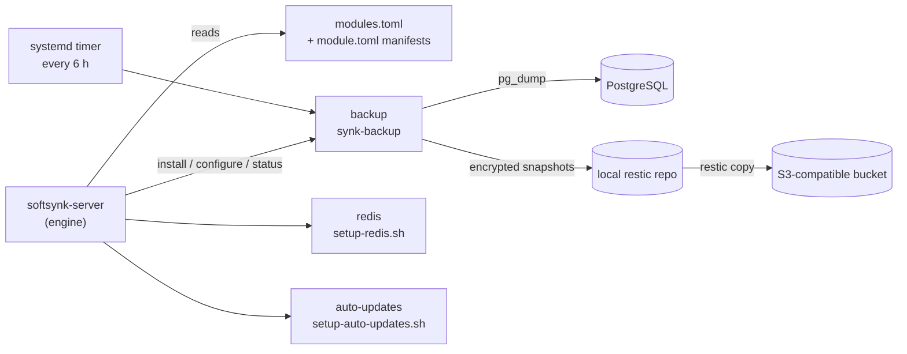

<div align="center">

# softsynk-server

**Encrypted PostgreSQL backups, Redis setup and automatic security updates for Ubuntu servers, managed by one command.**

[](LICENSE)


</div>

---

Setting up a single VPS properly means wiring together backups, a cache and queue, and OS patching, then remembering how you did it. **softsynk-server** packages those jobs as small, auditable modules. Each one has a guided terminal wizard (built on [gum](https://github.com/charmbracelet/gum)), a non-interactive mode for automation, and a machine-readable health check. One command installs, updates, rolls back and reports on all of them.

**Built for:** developers and small teams running their own Ubuntu server (Laravel, Rails, Django, Node and similar stacks) who want production-grade basics without running a backup SaaS or a configuration-management platform.

## ✨ Modules

| Module | What it gives you |
|---|---|
| 🗄️ **`backup`** | Every PostgreSQL database plus its roles, dumped every 6 hours into an **encrypted, deduplicated [restic](https://restic.net) repository**, with an off-site copy in any S3-compatible bucket (presets for Cloudflare R2, Backblaze B2 and Hetzner Object Storage). Tiered retention, weekly integrity checks, monthly automatic restore tests, one-command restores and failure e-mails. |
| ⚡ **`redis`** | Installs and tunes Redis as **separate cache and queue instances** (or a single one): memory limits, eviction policy, persistence, password, localhost-only binding. Detects and adopts an existing setup instead of overwriting it. |
| 🔄 **`auto-updates`** | Configures **unattended-upgrades**: security and stable updates, chosen third-party repos (PHP from sury, nginx.org), reboots at a set time only when required, and an optional failure e-mail. Verifies the result with a dry run. |

## 🧭 Why it's different

- **Safe by default.** Every wizard validates all answers before it changes anything, and `--dry-run` shows the plan without touching the system. Credentials are accepted only through prompts or environment variables, never as command-line options that show up in `ps`.
- **Retention you can trust.** Only successful backups count, so a week of failures never deletes your good history. A failed off-site copy is retried on the next run.
- **Instant rollback.** Each release is installed read-only into its own folder behind a `current` symlink, and `softsynk-server --rollback` switches back.
- **No new runtime.** The engine and the backup runner are single Python files using only the standard library, and the rest is Bash. The only extra packages are `gum` and `restic`, both from the Ubuntu archive.
- **Scriptable.** Every module works with `--non-interactive`, reports health as JSON, and uses the same exit codes (`0` healthy, `1` degraded, `2` unhealthy, `3` incomplete).

## 🏗️ How it fits together



The engine contains no module-specific code: a module is a folder with a data-only manifest that declares its dependencies, supported platforms and commands. See [Architecture](docs/architecture.md).

## 🚀 Quick start

**Requirements:** Ubuntu with systemd, root access, Python 3.11+, Bash 4.4+. The backup module needs Ubuntu 26.04 or newer, `restic` 0.17.1+ and the PostgreSQL client tools. The Redis module also runs on Debian.

**1. Build a release** on your own machine, from a clone of this repo:

```bash
git archive --format=tar.gz --prefix="softsynk-server-$(cat VERSION)/" -o "softsynk-server-$(cat VERSION).tar.gz" HEAD
shasum -a 256 "softsynk-server-$(cat VERSION).tar.gz"
```

**2. Install it** on the server as root, after copying the tarball there:

```bash
tar -xzf softsynk-server-0.1.0.tar.gz
bash softsynk-server-0.1.0/bootstrap.sh --from softsynk-server-0.1.0.tar.gz --sha256 <sha256-from-step-1> --install
```

`--install` installs `gum` with apt and opens the module menu. The release lands in `/opt/softsynk-server-management`, and `softsynk-server` and `synk-backup` are linked into `/usr/local/bin`.

**3. Check health** (example output):

```console
$ softsynk-server --status
softsynk-server 0.1.0 (interface 1), root /opt/softsynk-server-management
MODULE        INSTALL    HEALTH   SUMMARY
backup        installed  healthy  ...
redis         adopted    healthy  ...
auto-updates  installed  healthy  ...
overall: healthy (exit 0)
```

## 🛠️ Everyday commands

```bash
softsynk-server                       # interactive menu
softsynk-server install backup        # install one module (dependencies first)
softsynk-server configure redis       # change a module's settings
softsynk-server --list                # modules, install state, blockers
softsynk-server --status --json       # health for monitoring
softsynk-server update --from softsynk-server-0.2.0.tar.gz --sha256 <hex>
softsynk-server --rollback            # back to the previous release

synk-backup --status                  # backup health and last runs
synk-backup snapshots --from remote   # what is in the bucket
synk-backup run --dry-run             # what the next run would do
synk-backup restore --db app --to-db app_restored   # restore beside the live database
```

Automate a setup without prompts:

```bash
sudo env SOFTSYNK_ANSWER_REPO_PASSWORD='...' SOFTSYNK_ANSWER_S3_ACCESS_KEY_ID='...' \
  SOFTSYNK_ANSWER_S3_SECRET_ACCESS_KEY='...' \
  deployment/backup/setup-backup.sh --non-interactive \
  --remote-preset r2 --remote-id ACCOUNT_ID --remote-bucket my-bucket
```

## 📚 Documentation

| Topic | Where |
|---|---|
| Backups: retention, setup, restore, health | [deployment/backup/README.md](deployment/backup/README.md) |
| Redis: modes, defaults, Laravel `.env` | [deployment/redis-setup/README.md](deployment/redis-setup/README.md) |
| Automatic updates: defaults, checks | [deployment/auto-updates/README.md](deployment/auto-updates/README.md) |
| Layout, commands, exit codes, update and rollback | [docs/architecture.md](docs/architecture.md) |
| Write your own module | [docs/module-development.md](docs/module-development.md) |
| Why restic, and the rejected alternatives | [docs/decisions/0001-backup-and-server-management.md](docs/decisions/0001-backup-and-server-management.md) |

## ⚠️ Project status

**0.1.0 is an early release.** The logic (retention, scheduling, manifest validation, status, update and rollback) is covered by about 250 automated tests, which use stubs for system tools. A real PostgreSQL and restic smoke test runs locally. Behaviour against live systemd, apt, S3 providers and mail relays has **not** yet been validated on a production server, so try it on a disposable VM first and keep your existing backups until you have done a test restore.

## 🤝 Contributing

Bug reports, fixes and new modules are welcome. Start with [CONTRIBUTING.md](CONTRIBUTING.md). Report security issues privately as described in [SECURITY.md](SECURITY.md).

## ⚖️ License

[CC0-1.0](LICENSE): dedicated to the public domain. Use, modify and redistribute it for any purpose, including commercial use, without asking and without attribution.
